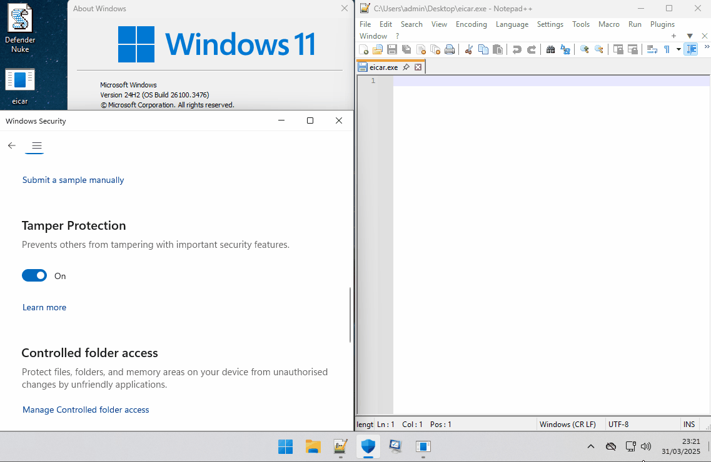

  

# Defender Nuke VBS

You need to be a local admin on the box. Defender will still be present on the system, however it will fail to operate, *effectively* nuked. Attempting to restart defender will return an "unexpected error". If you need to switch back on defender just undo the the registry key changes.

Script features:

- UAC Elevation
- Put's the system into safe mode
- Makes the registry key changes required to nuke defender while in safe mode
- Restarts machine back into normal mode

Tested and confirmed fully working on **Windows 11 Version 24H2 Build 26100.34**
Tested and confirmed fully working on **Windows 11 Version 24H2 Build 26100.3476**
Tested and confirmed fully working on **Windows 11 Version 25H2 Build 26200.9457**

To run it simply download and run DefenderNuke.vbs and follow the prompts. 

[CyberOps.Team_ Blog](https://blog.cyberops.team)
